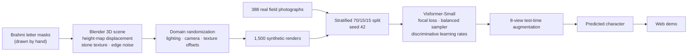
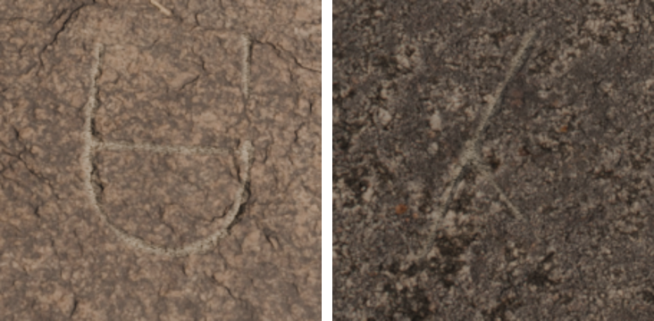
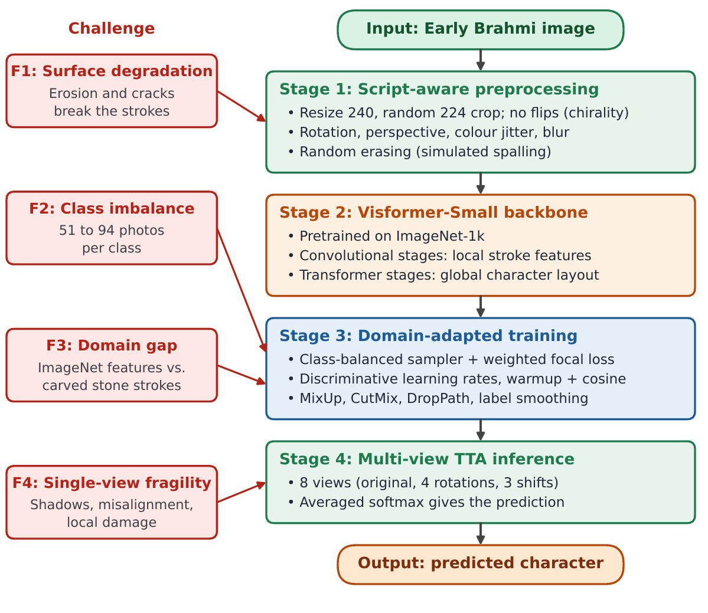
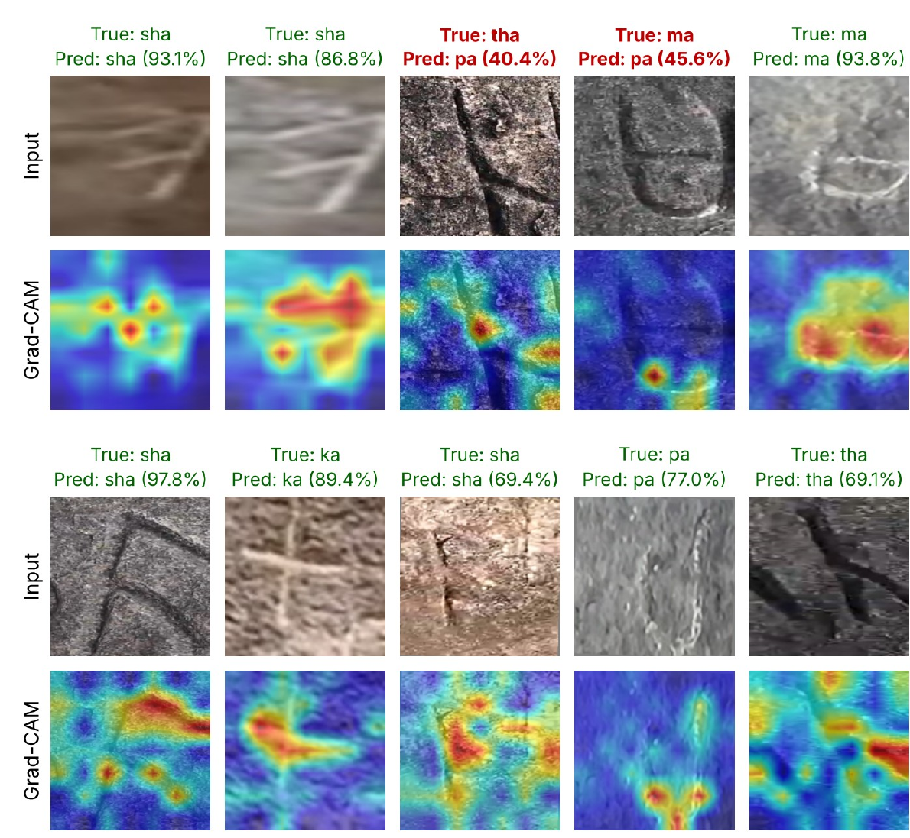

# 3D Procedural Synthesis for Early Brahmi Inscriptions

**Three-Dimensional Procedural Synthesis and Vision-Transformer Hybridization for Low-Resource Epigraphic Character Recognition in Early Brahmi Inscriptions**

*Namidu S. Wickramanayaka · Anna Kurera · Maheshi B. Dissanayake*
University of Peradeniya, Sri Lanka

[](https://n-s-wickramanayaka.github.io/brahmi-recognizer/)
[](#citation)
[](https://drive.google.com/file/d/1PkesWzOpYtJf4nP7uR5daArusIJwynBf/view?usp=drive-dynamite&ts=6af5d5bb)


</div>

---

Early Brahmi rock inscriptions (*Sel-Lipi*) are among the oldest written records in Sri Lanka. Weathering, uneven carving and rough stone make them hard to read, and only a few hundred labeled field photographs exist for training a recognizer.

This project addresses the shortage of data by **rendering carved Brahmi characters in 3D**. The renders use height-map displacement, photographic stone textures, stroke-edge noise and randomized lighting and camera position. We train a **hybrid CNN–Transformer (Visformer-Small)** on the renders combined with real photographs.

## Highlights

- 🪨 **1,500 procedurally rendered 3D characters.** Six classes, generated in Blender with domain randomization.
- 📸 **388 real field photographs.** A common set of **59 real test photographs** is excluded from all training.
- 📈 **+10.17 percentage points on real photographs.** Adding the renders lifts Visformer-Small from **83.05 % → 93.22 %** (TTA; exact McNemar test, *p* = 0.031).
- 🧪 **Benchmark of 9 models.** Random Forest, XGBoost, a shallow CNN, VGG-16, ResNet-34, Xception, ViT-Small/16 (frozen and fine-tuned) and Visformer-Small.
- 🌐 **Live web demo.** Upload a photo, draw a box around a letter and get a prediction in your browser.

## Try it online

> ### 👉 [n-s-wickramanayaka.github.io/brahmi-recognizer](https://n-s-wickramanayaka.github.io/brahmi-recognizer/)

1. **Upload** a photo of an inscription, or pick one of the **example photos** below the upload box.
2. **Draw a box** around the letter you want identified, or analyze the whole image.
3. Get the **top predictions** with their confidence, each shown beside a reference image of the letter.

The page runs entirely in your browser. Only the selected area is sent to the recognition model, which runs on a separate server.

> **Tip:** the model server sleeps when idle, so the first request can take up to about a minute. The page retries automatically.

Website source code: [`n-s-wickramanayaka/brahmi-recognizer`](https://github.com/n-s-wickramanayaka/brahmi-recognizer). It is built with React, Vite and TypeScript and hosted on GitHub Pages.

## How it works



<p align="center">
  <br>
  <em>Procedurally rendered characters <b>ma</b> and <b>tha</b>: carved depth, stone texture and edge noise.</em>
</p>

<p align="center">
  <br>
  <em>The recognition framework: each stage addresses one challenge of field epigraphy.</em>
</p>

## Results

All three Visformer-Small models are evaluated on the **same 59 real field photographs**, which none of them saw during training.

| Training data | Accuracy on real photographs (TTA) |
|---|:---:|
| 3D synthetic renders only | 35.59 % |
| Real photographs only | 83.05 % |
| **Real + 3D synthetic (combined)** | **93.22 %** |

The combined model corrects 6 real photographs that the real-only model got wrong, and gets none wrong that the real-only model got right (exact McNemar test, *p* = 0.031).

<details>
<summary><b>Comparison with other models (Combined Hybrid configuration)</b></summary>

| Model | Test acc. | TTA acc. | Macro F1 | Real photos (TTA) |
|---|:---:|:---:|:---:|:---:|
| Random Forest | 36.27 | – | 36.30 | – |
| XGBoost | 38.03 | – | 37.51 | – |
| Basic CNN (from scratch) | 89.79 | – | 89.79 | – |
| VGG-16 | 97.18 | 97.54 | 97.22 | 91.53 |
| ResNet-34 † | 99.65 | 99.65 | 99.64 | 98.31 |
| Xception | 95.77 | 95.77 | 95.90 | 91.53 |
| ViT-Small/16 (frozen) | 77.11 | 85.56 | 77.51 | 67.80 |
| ViT-Small/16 (fine-tuned) ‡ | 98.24 | 98.59 | 98.29 | 96.61 |
| **Visformer-Small (ours)** | **97.89** | **98.24** | **97.92** | **93.22** |

Values are percentages on the 284-image combined test split. The last column is the 59 shared real photographs.
† Learning rates and pretrained weights were selected on validation data.
‡ Pretrained on ImageNet-21k; the other pretrained models use ImageNet-1k.
The Real Photographic, 3D Synthetic and all single-view results are given in Tables 7–9 of the paper.

Adding the 3D renders **improved real-photograph accuracy for six of the seven neural models**. The exception was ViT-Small/16 with a frozen backbone.

</details>

<details>
<summary><b>Where does the model look? (Grad-CAM)</b></summary>
<p align="center">
  <br>
  <em>Grad-CAM for the real-only model on 10 real test photographs (red = strong contribution, blue = little). Green titles are correct predictions; red titles are errors.</em>
</p>
</details>

## Repository contents

| File | What it is |
|---|---|
| [`Model_trainer.ipynb`](Model_trainer.ipynb) | **Main experiment notebook.** Builds the reproducible splits, trains and evaluates all models in all data configurations (22 runs) and produces the paper's figures and numbers. It runs on Kaggle, Colab or a local GPU, and resumes automatically after an interruption. |
| [`Brahmi_letter_recognizer.ipynb`](Brahmi_letter_recognizer.ipynb) | Original Colab notebook for the Visformer-Small recognizer: training, TTA evaluation, confusion matrix, Grad-CAM, single-image prediction and ONNX export. |
| [`LICENSE`](LICENSE) | MIT license for the code. |

## Dataset

**Download:** [Google Drive](https://drive.google.com/file/d/1PkesWzOpYtJf4nP7uR5daArusIJwynBf/view?usp=drive-dynamite&ts=6af5d5bb). The complete dataset is available on reasonable request from the corresponding author.

| Set | *ka* | *ga* | *ma* | *pa* | *sha* | *tha* | Total |
|---|:---:|:---:|:---:|:---:|:---:|:---:|:---:|
| Real field photographs | 65 | 94 | 60 | 51 | 66 | 52 | **388** |
| 3D synthetic renders | 200 | 200 | 275 | 275 | 275 | 275 | **1,500** |
| Combined | 265 | 294 | 335 | 326 | 341 | 327 | **1,888** |

The notebooks expect two archives, `real.zip` and `synthetic.zip`. Inside each, images sit in one folder per class, and the folder name is the label:

```
real.zip
└── real/
    ├── ga/   *.jpg
    ├── ka/
    ├── ma/
    ├── pa/
    ├── sha/
    └── tha/
```

Splits are stratified 70 / 15 / 15 (seed 42). This gives 271 / 58 / 59 real images and 1,050 / 225 / 225 synthetic images. The combined configuration is the union of the two, so **every configuration is tested on the same 59 real photographs**.

## Reproduce the experiments

Open [`Model_trainer.ipynb`](Model_trainer.ipynb). Its first cell explains each option in detail.

<details open>
<summary><b>Kaggle (recommended, free T4 GPU)</b></summary>

1. Create a private Kaggle dataset containing `real.zip` and `synthetic.zip`.
2. **Create → New Notebook → File → Import Notebook**, then select `Model_trainer.ipynb`.
3. **Add Input** → your dataset. Under **Settings**, choose Accelerator **GPU T4 ×2** and turn Internet **on**.
4. **Save Version → Save & Run All**. Results appear in the version's Output, in the `brahmi_revision/` folder.
</details>

<details>
<summary><b>Google Colab</b></summary>

Put `real.zip` and `synthetic.zip` in the root of your Google Drive. Then choose **Runtime → Change runtime type → T4 GPU** and **Run all**. Results go to `MyDrive/brahmi_revision/`. If the session disconnects, **Run all** again: finished runs are skipped.
</details>

<details>
<summary><b>Your own computer (NVIDIA GPU)</b></summary>

```bash
# 1. Install PyTorch with CUDA: https://pytorch.org/get-started/locally/
# 2. Install the other packages
pip install timm==0.9.12 grad-cam xgboost scikit-learn matplotlib seaborn tqdm jupyter
# 3. Put real.zip and synthetic.zip in ./data next to the notebook, then:
jupyter notebook Model_trainer.ipynb   # Run All
```
GPUs with less than 5.5 GB of memory skip VGG-16.
</details>

**Outputs:**
- `runs/`: one result file per run.
- `figures/`: training curves, confusion matrices and Grad-CAM grids.
- `revision_outputs.zip`: everything above in one archive.

**Training recipe** (shared by all neural models):

| Setting | Value |
|---|---|
| Input | Resize 240 → random 224 crop (train); 224 (test); **no flips** (Brahmi letters are chiral) |
| Augmentation | Rotation ±8°, perspective, affine, color jitter, Gaussian blur, random erasing, MixUp/CutMix |
| Loss | Class-weighted focal loss (γ = 2) with label smoothing 0.1 |
| Sampling | Class-balanced weighted random sampler |
| Optimizer | AdamW; learning rates 5e-6 (early backbone), 5e-5 (late backbone), 5e-4 (head); 5-epoch warmup + cosine schedule |
| Training | 60 epochs max, early stopping (patience 15), mixed precision, batch size 16 |
| Inference | 8-view test-time augmentation (original, ±3°, ±5°, three 2-pixel shifts) |

The validation-selected settings for ResNet-34 and the Basic CNN are described in Section 4.7 of the paper.

## Citation

If you use this code, dataset or demo, please cite:

```bibtex
@article{wickramanayaka2026brahmi,
  title   = {Three-Dimensional Procedural Synthesis and Vision-Transformer Hybridization
             for Low-Resource Epigraphic Character Recognition in Early Brahmi Inscriptions},
  author  = {Wickramanayaka, Namidu S. and Kurera, Anna and Dissanayake, Maheshi B.},
  journal = {Heritage},
  publisher = {MDPI},
  year    = {2026},
  note    = {Accepted for publication}
}
```

## Authors

| | |
|---|---|
| **Namidu S. Wickramanayaka** | Department of Computer Engineering, University of Peradeniya |
| **Anna Kurera** | Department of Computer Engineering, University of Peradeniya |
| **Prof. Maheshi B. Dissanayake** (corresponding author) | Department of Electrical and Electronic Engineering, University of Peradeniya · maheshid@eng.pdn.ac.lk |

## Acknowledgments

This work was supported by the Multidisciplinary Research Grant scheme (2025) of the University of Peradeniya under **Grant No. MRG_06_2025**.

We thank G. C. J. I. Guruge, U. D. R. S. Thilakarathna, A. J. Pinidiyaarachchi, W. I. Malsiri and M. Niranjan for their help with data preparation and project administration.

## License

The code is released under the [MIT License](LICENSE).
